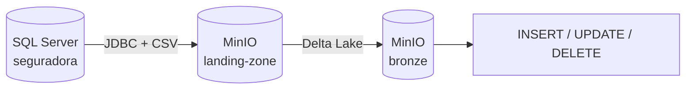

# SQL Server → MinIO → Delta Lake com Apache Spark

## Descrição

Pipeline com **PySpark** que extrai todas as tabelas de um banco **SQL Server** (`seguradora`), grava-as em CSV no bucket **`landing-zone`** do **MinIO**, converte para **Delta Lake** no bucket **`bronze`** e reproduz `INSERT`, `UPDATE` e `DELETE` nas tabelas Delta.

Trabalho 2 de Engenharia de Dados (UNISATC), Prof. Jorge Luiz da Silva. Complementa o [trabalho 1](https://github.com/raffaelarcego/trabalho-apachespark-eng_dados) (Delta Lake e Apache Iceberg).

**Integrantes:** Raffael Michels Arcego · Isabelle Luiz Feltrin

📖 **Documentação completa:** https://isabellefeltrin.github.io/spark-delta-minio-sqlserver/



## Disclaimer

- O Spark 3.5 exige **Java 17**. Versões 21 ou superiores não funcionam.
- Na primeira execução, o Spark baixa os JARs (Delta, hadoop-aws, driver JDBC do SQL Server) pela internet.
- O SQL Server em contêiner precisa de **pelo menos 2 GB de RAM** livres para o Docker.
- Os comandos são executados no **terminal do Ubuntu (WSL)**, e não no PowerShell.

## Pré-requisitos

- Windows 11 com **WSL 2 (Ubuntu)**
- **Java 17**
- **Docker** com Compose v2
- **[uv](https://docs.astral.sh/uv/)** (gerenciador de pacotes; ele também instala o Python 3.11)

| Componente         | Versão                         |
| ------------------ | ------------------------------ |
| pyspark            | 3.5.x                          |
| delta-spark        | 3.3.2                          |
| hadoop-aws         | 3.3.4                          |
| mssql-jdbc         | 12.8.1                         |
| SQL Server         | 2022 (contêiner)               |
| MinIO              | RELEASE.2025-02-03 (contêiner) |
| jupyterlab, mkdocs | 4.x, 1.6 + material            |

## Instalação

```bash
# 1. Java 17
sudo apt update && sudo apt install -y openjdk-17-jdk-headless

# 2. uv
curl -LsSf https://astral.sh/uv/install.sh | sh
source ~/.bashrc

# 3. Projeto
cd ~
git clone https://github.com/isabellefeltrin/spark-delta-minio-sqlserver.git
cd spark-delta-minio-sqlserver
uv sync
cp .env.example .env   # opcional: os valores padrão já funcionam
```

## Howto

```bash
docker compose up -d      # SQL Server (cria e popula o banco) + MinIO
uv run jupyter lab
```

Rode os notebooks em ordem, cada um com **Run All**:

| Notebook                                | O que faz                                                                 |
| --------------------------------------- | ------------------------------------------------------------------------- |
| `00_sqlserver_para_landing.ipynb`       | Extrai todas as tabelas do SQL Server para CSV no bucket `landing-zone`   |
| `01_landing_para_bronze.ipynb`          | Lê os CSVs e grava em Delta Lake no bucket `bronze`                       |
| `02_dml_delta.ipynb`                    | `INSERT`, `UPDATE`, `DELETE`, histórico e _time travel_ na tabela `carro` |
| `03_gerenciada_vs_nao_gerenciada.ipynb` | Compara tabelas gerenciadas e não gerenciadas                             |

Console do MinIO: http://localhost:9001 (`minioadmin` / `minioadmin`).

Para encerrar: `docker compose down` (acrescente `-v` para apagar os dados).

## Testes

```bash
uv run task test    # pytest com cobertura
uv run task lint    # ruff, blue e isort
uv run task format  # corrige a formatação
```

## Documentação

```bash
uv run mkdocs serve       # visualizar localmente em http://127.0.0.1:8000
uv run mkdocs gh-deploy   # publicar no GitHub Pages
```

## Estrutura

```
├── spark_delta_minio_sqlserver/   # pacote Python (sessão Spark, extração e conversão)
├── notebooks/                     # 00 a 03, em ordem de execução
├── sql/01_seguradora.sql          # cria e popula o banco (4 tabelas)
├── docker-compose.yml             # SQL Server e MinIO
├── tests/                         # testes com pytest
├── docs/                          # páginas do MkDocs
├── mkdocs.yml
└── pyproject.toml                 # dependências e tarefas (uv + taskipy)
```

## Problemas comuns

<details>
<summary><b>Sem internet no Ubuntu (WSL)</b>: <code>apt</code> ou <code>uv sync</code> falham com <i>Network is unreachable</i></summary>

Crie o arquivo `C:\Users\<seu-usuario>\.wslconfig` no Windows com:

```ini
[wsl2]
networkingMode=mirrored
dnsTunneling=true
autoProxy=true
```

Depois, no PowerShell, rode `wsl --shutdown`, abra o Ubuntu de novo e teste com `curl -I https://pypi.org`.

</details>

<details>
<summary><b><code>JAVA_GATEWAY_EXITED</code></b> ou <b><code>JAVA_HOME is not set</code></b></summary>

```bash
java -version                              # deve mostrar 17
sudo update-alternatives --config java     # se houver mais de uma versão, escolha a 17
```

</details>

<details>
<summary><b>Notebook 00 falha ao conectar no SQL Server</b></summary>

O contêiner `sqlserver-init` cria o banco depois que o SQL Server fica saudável. Confira com `docker compose ps -a` e `docker compose logs sqlserver-init`. Se a porta 1433 ou 9000 já estiver em uso, pare o outro serviço.

</details>

## Referências

- [jlsilva01/spark-delta-minio-sqlserver](https://github.com/jlsilva01/spark-delta-minio-sqlserver) (repositório modelo do professor)
- [Delta Lake](https://docs.delta.io/) · [Apache Spark](https://spark.apache.org/docs/3.5.3/) · [MinIO](https://min.io/docs/minio/container/index.html) · [Hadoop S3A](https://hadoop.apache.org/docs/r3.3.4/hadoop-aws/tools/hadoop-aws/index.html)

## Uso de IA

O Claude (Anthropic) foi usado como apoio para estruturar o projeto, revisar código e documentação. O grupo executou, conferiu e revisou tudo.
