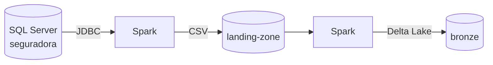
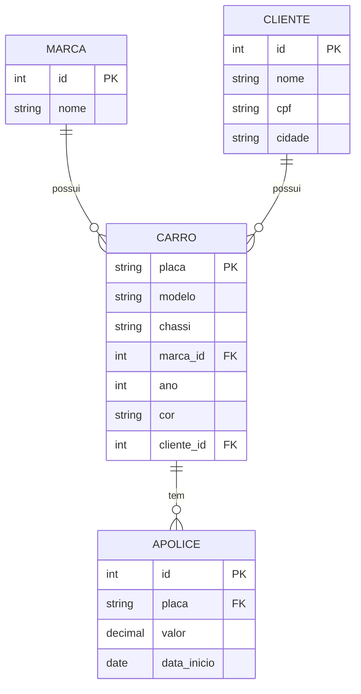

# Contexto

Trabalho 2 de Engenharia de Dados. Extrai as tabelas de um banco relacional (**SQL Server**), guarda os arquivos no **MinIO** e converte para **Delta Lake**, seguindo a arquitetura em camadas:

| Camada  | Bucket         | Formato    | Conteúdo                              |
| ------- | -------------- | ---------- | ------------------------------------- |
| Origem  | —              | SQL Server | banco `seguradora`                    |
| Landing | `landing-zone` | CSV        | cópia fiel de cada tabela             |
| Bronze  | `bronze`       | Delta Lake | mesma estrutura, com ACID e histórico |

## Banco de origem

O script `sql/01_seguradora.sql` cria as 4 tabelas e insere os dados. O cadastro `carro` usa o mesmo dataset do trabalho 1.

## Ambiente

- **Docker Compose**: SQL Server 2022 (porta 1433) e MinIO (API 9000, console 9001).
- **Spark local** (`local[*]`) com os pacotes `delta-spark`, `hadoop-aws` (acesso S3A ao MinIO) e `mssql-jdbc`.
- Os dois repositórios são independentes: o trabalho 1 cobre Delta Lake **e** Iceberg em disco local; este cobre só Delta Lake sobre object storage.
